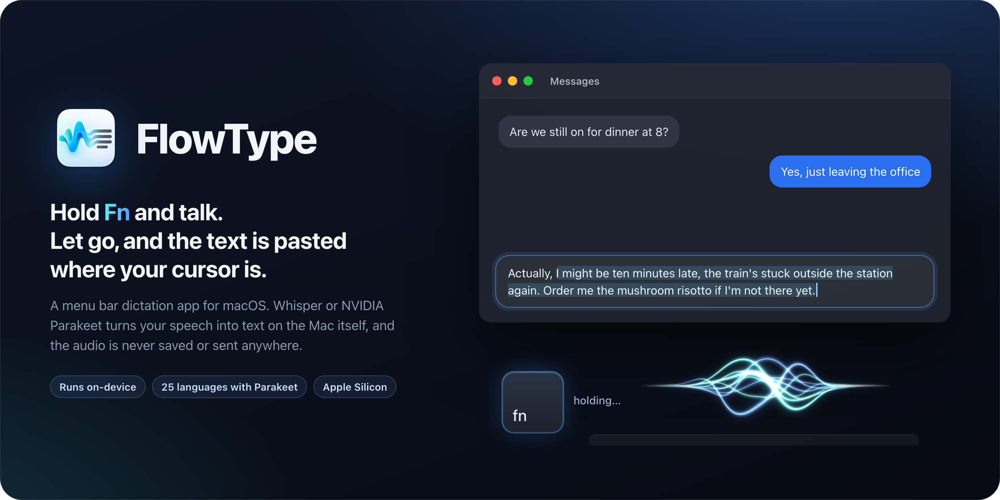
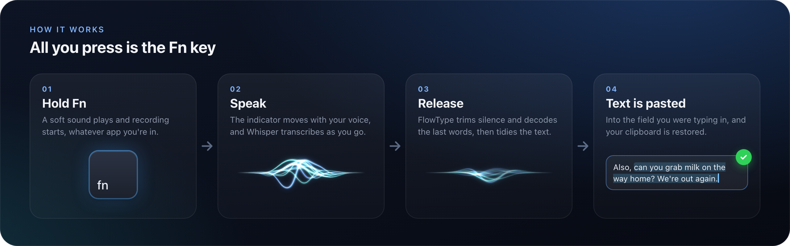
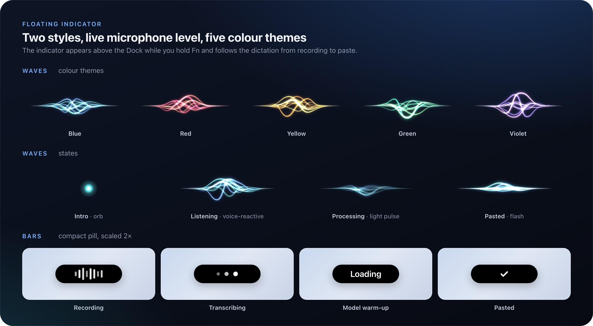
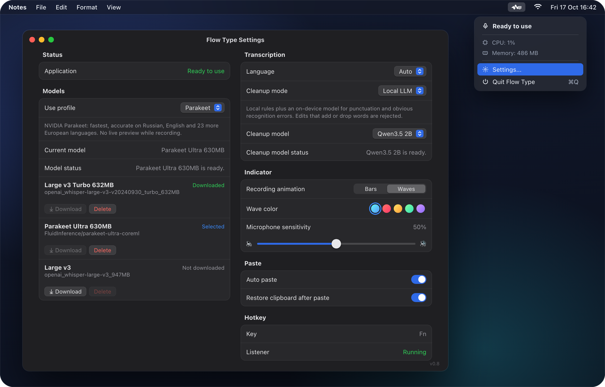
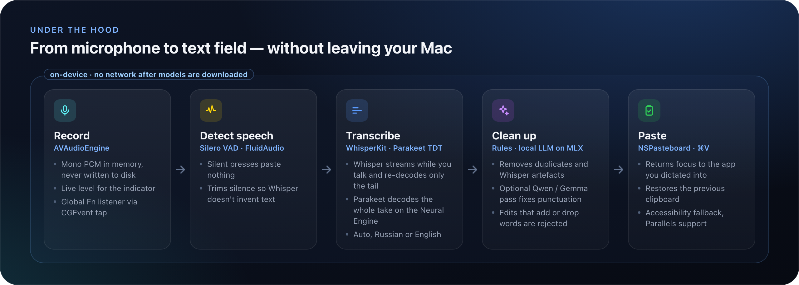

<p align="center">
  
</p>

# FlowType

[](#requirements)
[](https://developer.apple.com/swift/)
[](#privacy)
[](LICENSE)

**FlowType** is a free, open-source macOS menu bar app for dictating text into any app.
Hold `Fn`, speak, release — and the recognised text is pasted wherever your cursor is.

Recognition runs **entirely on your Mac**: audio never leaves the device and is never written to disk. The network is only needed once, to download the models.

## How it works

<p align="center">
  
</p>

1. **Hold `Fn`.** Recording starts in any app, a short cue plays and the indicator appears above the Dock.
2. **Speak.** The indicator reacts to your voice. Whisper models transcribe while you talk.
3. **Release `Fn`.** Silence is trimmed, the remaining tail is decoded and the text is cleaned up.
4. **The text is pasted** into the field that had focus. Your previous clipboard contents are restored.

If you press `Fn` and say nothing, nothing is pasted: the speech detector drops empty recordings.

## Features

### Speech recognition

| Profile | Model | When to use |
|---|---|---|
| **Fast** | Whisper Tiny | Quick start, lower accuracy |
| **Balanced** *(default)* | Whisper Large v3 Turbo, 632 MB | Good accuracy at a small size |
| **Accurate** | Whisper Large v3, 947 MB | Best Whisper accuracy, slower start |
| **Parakeet** | NVIDIA Parakeet TDT Ultra, 630 MB | Fastest; accurate on Russian, English and 23 more European languages |

- **Language:** auto-detect, Russian or English.
- **Streaming recognition (Whisper).** Text is recognised while you record, so there is very little to wait for after releasing `Fn`. The finalization mode is configurable:
  - *Stream + tail* — keeps the confirmed streaming text and re-decodes only the tail;
  - *Full recording* — transcribes the whole recording after the key is released (the baseline for comparison);
  - *Stream only* — streaming text only; the fastest, but the last words are less reliable.
- **Parakeet** runs on the Neural Engine and decodes the whole recording in a fraction of a second, with no streaming preview.
- **Silero VAD** checks whether a recording contains speech and trims silence; otherwise Whisper tends to hallucinate subtitle phrases such as "To be continued..." on silent audio.
- The model is warmed up in advance and stays in memory. Loading progress is shown in the menu and in Settings.

### Text cleanup

- **Local rules** *(default)* — fast built-in rules that remove repeated fragments and typical Whisper artefacts.
- **Local LLM** — the rules plus a small on-device language model on [MLX](https://github.com/ml-explore/mlx-swift-lm) that fixes punctuation and obvious recognition errors. An edit is rejected if the model adds or drops words, so what you said is never changed.

  | Model | Size | Notes |
  |---|---|---|
  | Qwen2.5 1.5B | 0.9 GB | Fastest, best for short phrases |
  | Qwen3.5 2B | 1.7 GB | Noticeably better with Russian |
  | Qwen3 4B | 2.3 GB | Most careful edits, about twice as slow |
  | Gemma 4 E2B | 3.6 GB | Strong multilingual model from Google |

- **Off** — basic cleanup only.

### Pasting

- The text is put on the clipboard and pasted with `⌘V` into the app where you started dictating.
- The clipboard is restored after pasting (can be turned off).
- If `⌘V` fails, the text is inserted through the Accessibility API. If that fails too, it stays on the clipboard.
- **Parallels Desktop** is handled separately, since it syncs the clipboard with the guest OS asynchronously.
- Auto-paste can be turned off, in which case the text is only copied.

### Recording indicator

<p align="center">
  
</p>

- **Waves** — glowing waves that open out of an orb, react to your voice, carry a travelling pulse of light while processing and flash on paste. Five colour themes: blue, red, yellow, green and violet. Drawn with Core Animation instead of SwiftUI's Metal renderer, so they use almost no GPU memory.
- **Bars** — a compact pill with level bars, dots while transcribing and a checkmark after pasting.
- **Microphone sensitivity** is adjustable: at low values the indicator ignores background noise.
- The indicator appears almost instantly and collapses right after the paste instead of lingering on screen.

### Sounds

- Short cues mark the start and end of recording and a successful paste, so you don't need to watch the screen.
- The volume is adjustable with a slider, and sounds can be turned off entirely. Each cue has a play button for previewing it.
- While the start cue plays, the indicator doesn't mistake it for your voice. With sounds off, the waves react to speech straight away.

### Menu and settings

<p align="center">
  
</p>

- The menu shows the status, model loading progress, and the CPU and memory used by the app.
- Settings live in one window with a sidebar, like System Settings:
  - **General** — hotkey, auto-paste and clipboard restore, open at login, reset settings;
  - **Permissions** — microphone and Accessibility; changes made in System Settings are picked up automatically;
  - **Models** — profile choice, model download and deletion, loading progress of the active model;
  - **Transcription** — language, streaming mode and text cleanup;
  - **Indicator** — style, colour and sensitivity, with a live preview of the indicator;
  - **Sounds** — on/off, volume and cue previews.
- On first launch, an onboarding window offers to download the recommended model.

## Under the hood

<p align="center">
  
</p>

| Stage | Technology |
|---|---|
| Global `Fn` hotkey | `CGEvent` tap (listen-only) |
| Recording | `AVAudioEngine`, mono PCM in memory, resampled to 16 kHz |
| Speech detection | Silero VAD via [FluidAudio](https://github.com/FluidInference/FluidAudio) |
| Recognition | [WhisperKit](https://github.com/argmaxinc/argmax-oss-swift) (Core ML), NVIDIA Parakeet TDT via FluidAudio |
| Cleanup | Custom rules, LLM via [MLX Swift LM](https://github.com/ml-explore/mlx-swift-lm) |
| Pasting | `NSPasteboard`, `CGEvent` for `⌘V`, Accessibility API |
| UI | SwiftUI `MenuBarExtra`, `NSPanel` for the indicator, Core Animation |

```text
FlowType/
  App/        AppState, indicator and onboarding controllers
  Models/     settings, profiles, models, statuses
  Services/   hotkey, recording, VAD, transcription, cleanup, pasting, permissions
  UI/         menu, settings, onboarding, indicators
  Utils/      clipboard and text helpers
  Sounds/     feedback sounds
```

## Requirements

- macOS 14.0 or later
- Apple Silicon Mac (recommended)
- Xcode 16 or later to build
- Permissions: **Microphone** for recording and **Accessibility** for the global hotkey and pasting

## Build and run

```bash
git clone git@github.com:olchu/flowType.git
cd flowType
open FlowType.xcodeproj
```

Swift packages are resolved automatically. Run the `FlowType` scheme. On first launch:

1. Grant Microphone and Accessibility access (*Settings → Permissions*).
2. Download a model in the onboarding window or in *Settings → Models*.
3. Put the cursor in any text field, hold `Fn` and speak.

> If `Fn` opens the emoji picker or switches the input source, set "Press 🌐 key to" to *Do Nothing* in *System Settings → Keyboard*.

### Building a DMG

```bash
scripts/build_dmg.sh
```

The script builds Release and puts the image at `dist/Flow Type-<version>.dmg`.

> The build is signed with an Apple Development certificate and is not notarized, so Gatekeeper blocks it on first launch on another Mac. Open the app with right-click → *Open*, or click *Open Anyway* in *System Settings → Privacy & Security*.

### Debugging text cleanup

LLM cleanup can be run from the command line without recording:

```bash
# warm up (and download if needed) the cleanup model
"Flow Type.app/Contents/MacOS/Flow Type" --prewarm-cleanup-model --cleanup-model "Qwen3 4B"

# clean up a string and print the result, the decision and the timing
"Flow Type.app/Contents/MacOS/Flow Type" --cleanup-transcript "so um I wanted to to say that" --cleanup-model "Qwen3.5 2B"
```

### Tuning the waves look

A hidden **Wave Tuner** editor is available for design work. Open *Settings → Indicator* and quickly press `⌥` three times — a *Fine-tune…* button appears. The editor lets you toggle every layer (halo, glow, lines, orb, additive blending) and adjust its parameters while watching the result on white, gray and dark backgrounds. Values are saved and applied to the real indicator. The defaults live in `FlowType/UI/WaveAppearance.swift`.

## Privacy

- Audio is processed in memory and never saved.
- Recognition and cleanup run locally, with no cloud APIs.
- The network is used only to download models from Hugging Face.

## Acknowledgements

FlowType is built on these open-source projects:

- [WhisperKit](https://github.com/argmaxinc/argmax-oss-swift) by Argmax — MIT
- [FluidAudio](https://github.com/FluidInference/FluidAudio) by FluidInference (Parakeet and Silero VAD on Core ML) — Apache 2.0
- [MLX Swift](https://github.com/ml-explore/mlx-swift) and [MLX Swift LM](https://github.com/ml-explore/mlx-swift-lm) by Apple — MIT
- [swift-transformers](https://github.com/huggingface/swift-transformers) and [swift-huggingface](https://github.com/huggingface/swift-huggingface) by Hugging Face — Apache 2.0

Speech and language models are not bundled with the app. They are downloaded from Hugging Face on demand and are covered by their own licenses: OpenAI Whisper, NVIDIA Parakeet, Silero VAD, Qwen and Gemma.

## License

The FlowType source code is released under the [MIT License](LICENSE).

The FlowType name, the app icon, the menu bar icon and the images in `Docs/images` are not covered by the MIT License; all rights to them are reserved. If you publish a fork or a derived app, please give it a different name and icon.
